# Phoenix Music

A feature-packed music player for [CC: Tweaked](https://tweaked.cc/). Search YouTube, build playlists, sync wireless speakers around your base with **Speaker Link**, and control it all from a pocket remote.

Built by **Phoenix Software** on top of terreng's [computercraft-streaming-music](https://github.com/terreng/computercraft-streaming-music).

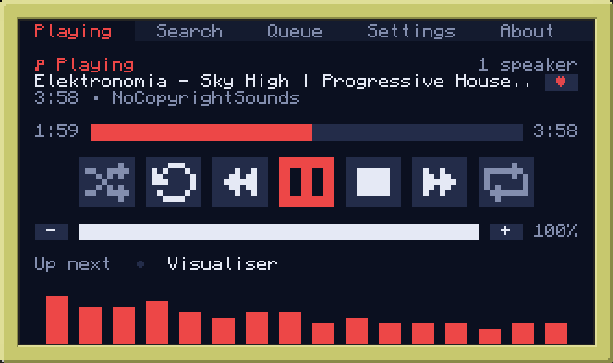

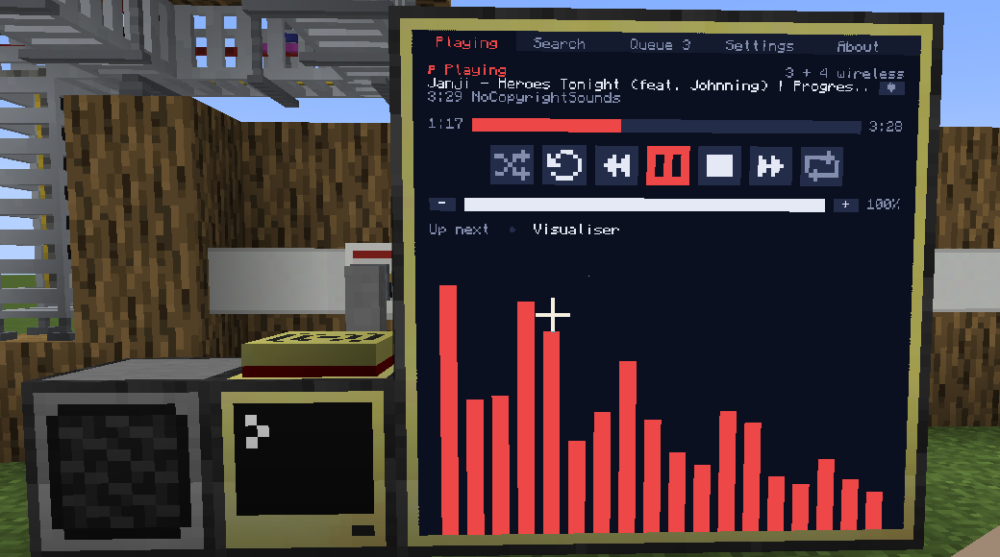

| Up next | Playlists |
| --- | --- |
| 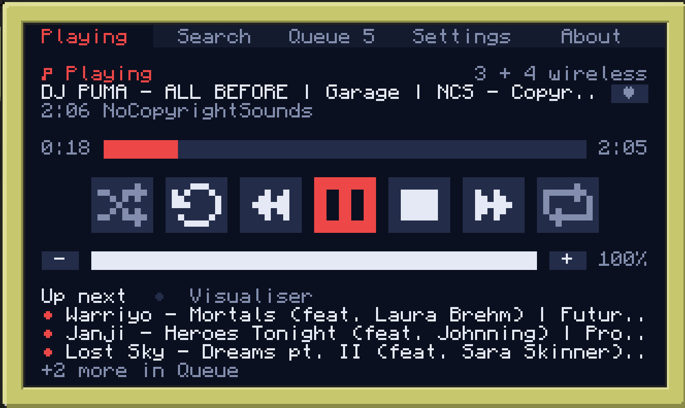 | 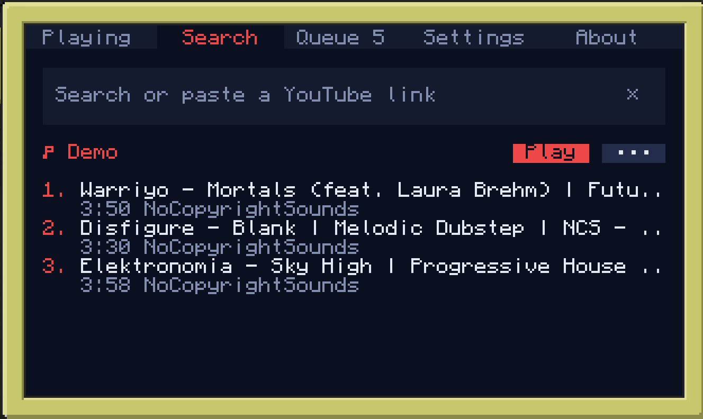 |
| **Library** | **Queue** |
| 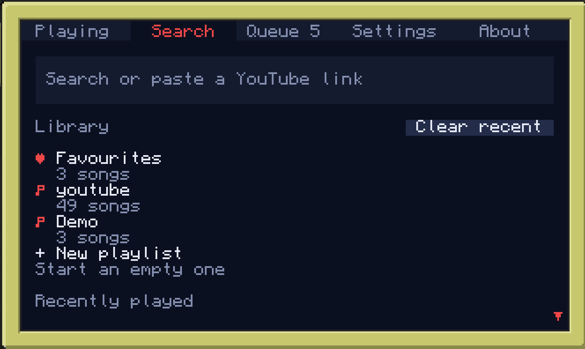 | 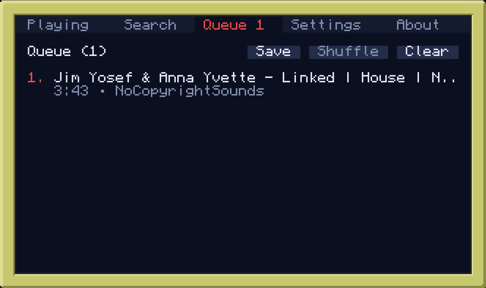 |
| **Settings** | **About** |
| 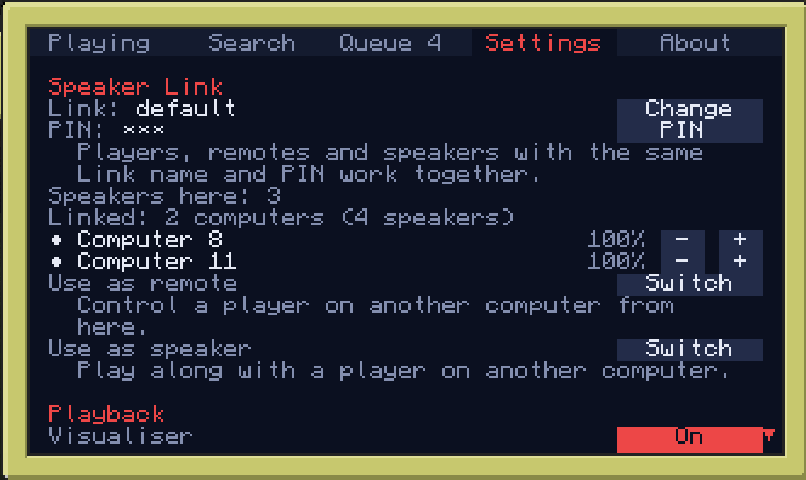 | 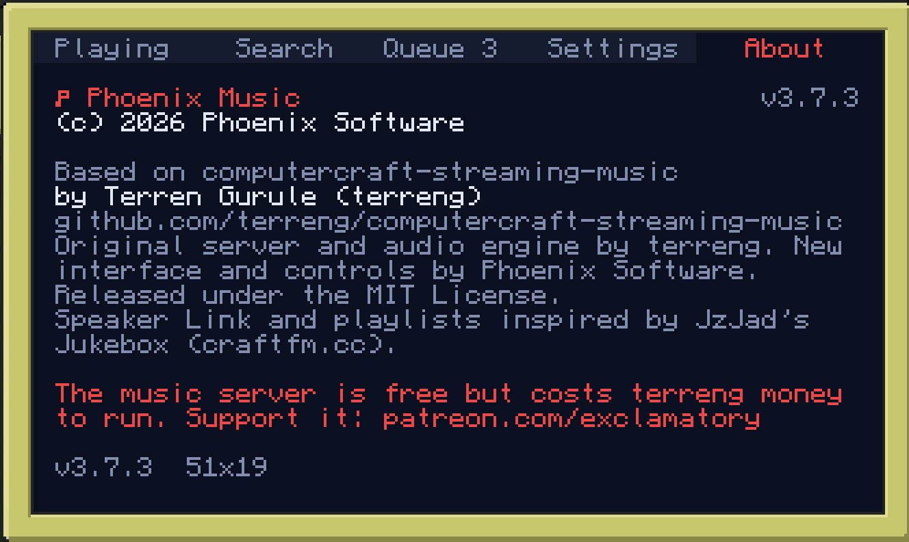 |

### Pocket computers

| Player | Remote |
| --- | --- |
| 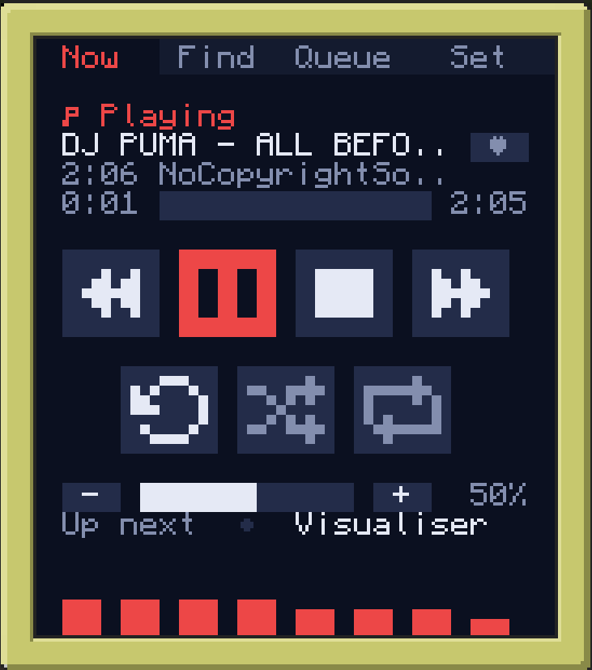 | 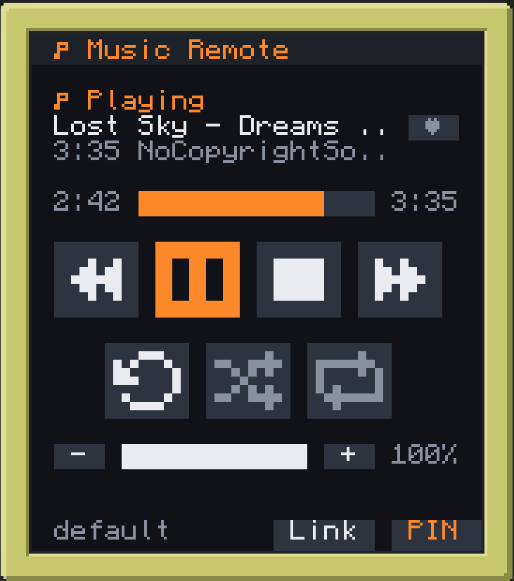 |

## Install

On an **Advanced Computer** (or Advanced Pocket Computer) with a speaker attached:

```
wget https://raw.githubusercontent.com/MADDXSTUDIOS/phoenix-music/main/phoenixmusic.lua phoenixmusic.lua
```

Then run:

```
phoenixmusic
```

Needs CC: Tweaked 1.100.0 or newer.

**Updating:** Phoenix Music checks for new versions when it opens and offers to update. You can also check any time under **Settings → Updates**. Your playlists, favourites and settings are kept.

## Features

- **Search and play** YouTube videos and playlists, or paste a link
- **Proper controls**: play/pause, stop, previous, next, restart, seek by tapping the progress bar
- **No wait between songs**: the next song downloads in the background while the current one plays
- **Instant replays**: the last few songs stay in memory, so going back or looping starts straight away
- **Loop** the queue or a single song, and **shuffle mode**
- **Queue** you can reorder, remove from, shuffle and save
- **Favourites and playlists**, plus a recently played list. Tap the heart to favourite what's playing, or the + under it to add it to a playlist
- **Picks up where you left off**: song, position, queue and settings survive a restart
- **Speaker Link**: play through speakers on other computers, in sync (even if one joins mid-song), with an optional PIN and per-speaker volume
- **Pocket remote**: control the player from anywhere with an ender modem
- **Wired speakers**: speakers on a wired modem network play as if they were attached, alongside linked ones
- **Switch modes from Settings**: turn any computer into a remote or a linked speaker without leaving the app
- **Visualiser** that moves with the music
- **Sleep timer, alarm and redstone trigger**
- **Themes**: Dark, Midnight or Light, with 8 accent colours
- **Audio smoothing** to take the edge off CC's crunchy sound
- **Shrugs off server hiccups**: a search that fails while the server wakes up is quietly retried
- **Auto-updates** from this repo
- **Monitor mirroring**: show the player on a monitor as well as the computer (Settings → Appearance → Monitor). Tap to control it on the monitor, type on the computer
- Works on computers, pocket computers and monitors, with mouse, touch and keyboard

## Commands

| Command | What it does |
| --- | --- |
| `phoenixmusic` | Run the player |
| `phoenixmusic <monitor> [scale]` | Run on a monitor only, e.g. `phoenixmusic monitor_0 0.5` |
| `monitor <side> phoenixmusic` | Run on the computer and mirror it to that monitor (or set it up in Settings → Appearance → Monitor) |
| `phoenixmusic link [name]` | Turn this computer into a wireless speaker on a Speaker Link (a standard grey computer does this with just `phoenixmusic`) |
| `phoenixmusic remote` | Turn this computer into a remote for a player |

On a computer with a modem but no speaker, Phoenix Music asks whether it should be a remote or drive linked speakers, and remembers your answer.

## Speaker Link

1. Give the player an **ender modem** or wireless modem. (Wired modems don't do Speaker Link: speakers on a wired network just play as the player's own.)
2. On each other computer, attach a speaker and a modem, then run `phoenixmusic link`.
3. They'll show up under **Settings → Speaker Link** on the player within a few seconds.

Or, on the other computer, open Phoenix Music and pick **Settings → Use as speaker**.

| Advanced computer | Standard computer |
| --- | --- |
| 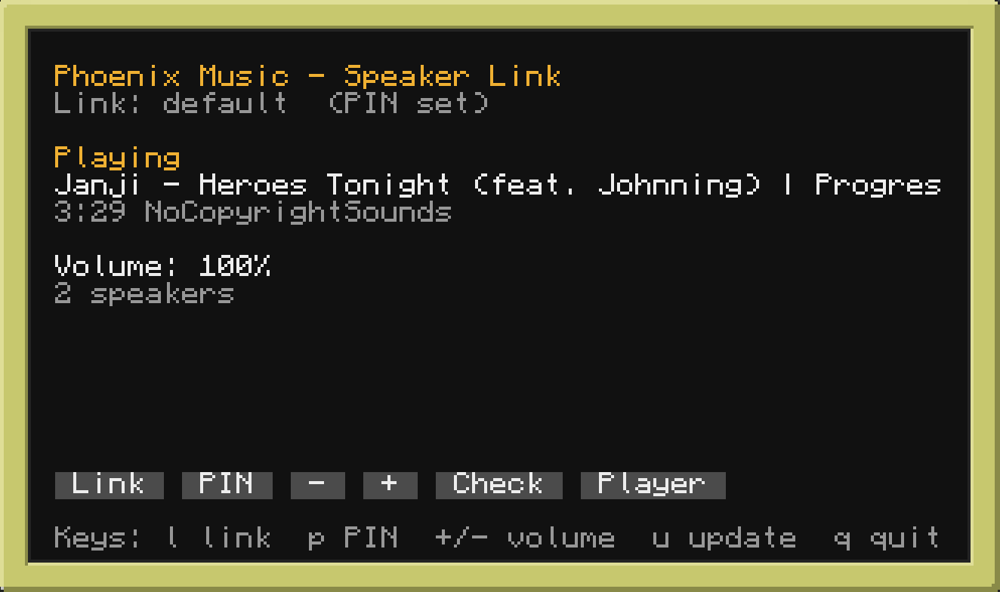 | 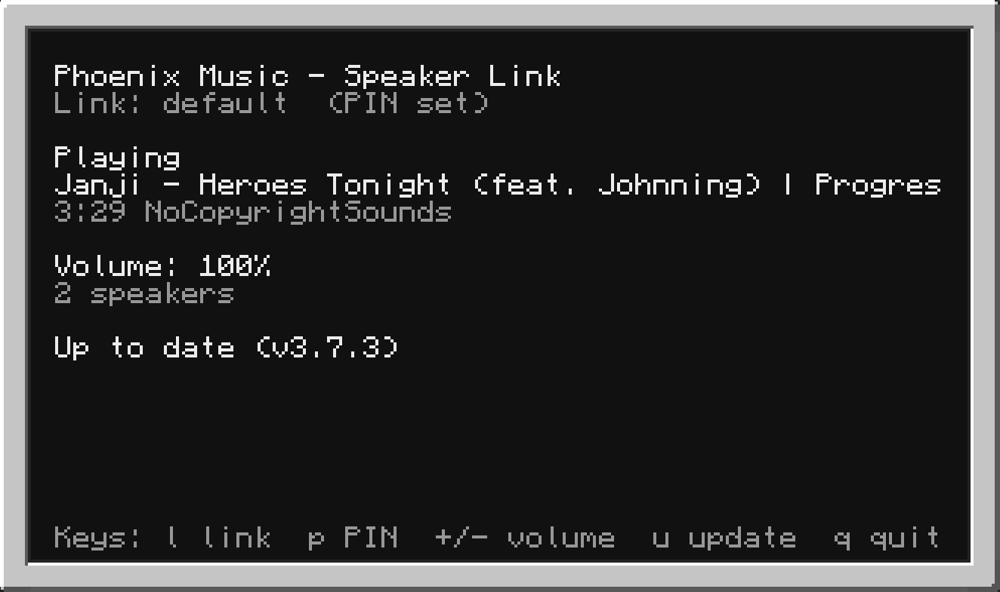 |

If the speakers ever drift apart, **Settings → Resync** starts them all again in step.

Use a different Link name to run separate zones, and set a PIN so nobody else can join or control your speakers. The player doesn't need its own speaker if it has linked ones.

## Keyboard shortcuts

| Key | Action |
| --- | --- |
| Space | Play / pause |
| ← / → | Seek 10 seconds |
| n / p | Next / previous |
| s | Stop |
| r | Restart |
| + / - | Volume |
| m | Mute |
| l | Loop mode |
| h | Shuffle |
| f | Favourite the current song |
| v | Visualiser on/off |
| / | Search |
| Tab | Switch tab |
| q | Quit |

## Known limits

- **Videos over about 15 minutes won't play.** This is a limit of the music server, not the player. They're hidden from search by default, along with **live streams**, which the server can't play at all (Settings → Long & live videos to show them).
- **Changing the volume** briefly restarts the sound from the same spot, because CC's speakers only pick up a new volume when they start afresh.
- **Audio quality** is limited by CC's speakers and audio format. Smoothing helps a little but it'll always sound like CC.
- **Phoenix Music uses terreng's free music server.** If it ever goes down, the player can't fetch music. Running it costs him money, so if you enjoy this, consider supporting him at [patreon.com/exclamatory](https://patreon.com/exclamatory).

## Roadmap

Ideas for where Phoenix Music could go next, and the CC limits they have to work within, are in [ROADMAP.md](ROADMAP.md). Nothing there is confirmed yet.

## Credits

- **terreng (Terren Gurule)**: original player, music server and audio engine
- **Phoenix Software**: new interface, controls and everything else
- **JzJad**: [Jukebox](https://craftfm.cc), which inspired Speaker Link and playlists

Released under the [MIT License](LICENSE).

## Development

Every push is checked automatically: the file has to compile, `version.txt` has to match the app's version, and a smoke test (`tests/`) runs the app against a fake CC computer on several screen sizes and modes with random clicks and keys. The updater reads the first line of `version.txt`, and the lines after it are shown as "What's new", so bump both when releasing. When a new version lands on `main` and passes the checks, a GitHub release (`vX.Y.Z`) is published automatically using `.github/release.md`.
